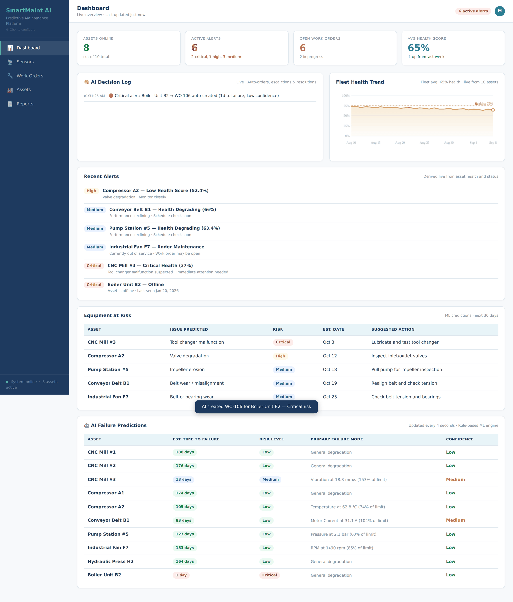
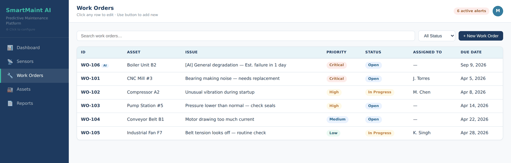
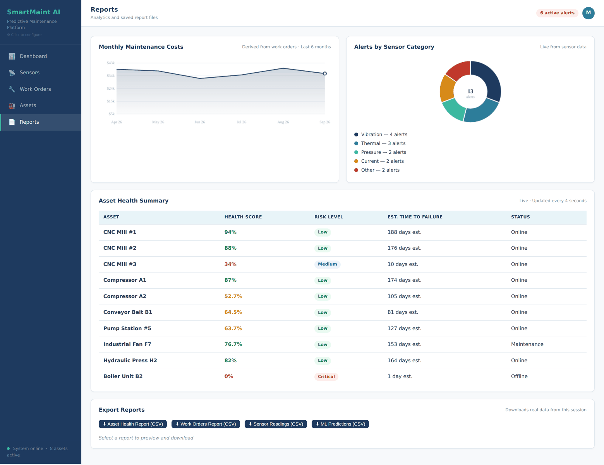
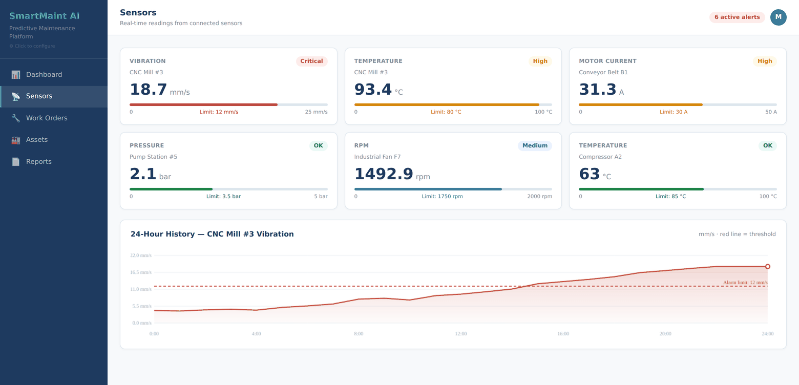

# SmartMaint AI — Predictive Maintenance Platform

**[▶ Open the live demo](https://muhammadb786.github.io/smartmaint-ai/)** · no install, no signup, works in any browser

A working prototype of an industrial predictive-maintenance platform. It simulates a live sensor
network, scores the health of every asset in real time, forecasts time-to-failure, and **opens,
escalates and closes its own work orders** without anyone clicking anything.

Built as a full systems-analysis project — requirements, architecture, data model, then a
functioning front end — for CSIT Systems Analysis & Design at Montclair State University.



---

## What actually happens when you open it

Leave the tab open and watch. Nothing here is a mockup or a static image:

| Every | The app does this |
|-------|-------------------|
| **4 seconds** | Each sensor takes a new reading (bounded random walk with a per-unit drift bias). Severity is re-derived from the reading-to-limit ratio, asset health decays or recovers accordingly, and every KPI, chart, alert and prediction on screen re-renders. |
| **12 seconds** | The auto-order engine re-scores every asset. Any asset at Critical or High risk that doesn't already have an open AI work order gets one created — with an estimated failure mode and a due date derived from its predicted days-to-failure. Assets that deteriorate further get their existing order **escalated**; assets that recover above 80% health get their order **auto-closed**. Each decision is written to the AI Decision Log with a timestamp. |

Work orders created this way are tagged `AI` in the table, so you can tell machine decisions from
human ones:



## The prediction engine, described honestly

This is a **deterministic rule-based engine, not a trained model.** There is no scikit-learn, no
training data and no inference. Calling it "AI" in the UI is product framing; here is the actual
maths, in full:

```
decayRate   = 0.5 + (0.8 × critical sensor count) + (0.3 × high sensor count)
baseDays    = assetHealth / decayRate
penalty     = maxExceedance > 1.2 ? (maxExceedance − 1.2) × 30 : 0
daysToFail  = max(1, round(baseDays − penalty))

risk        = ≤3 days Critical · ≤7 High · ≤14 Medium · else Low
confidence  = ≥3 alarming signals High · ≥1 Medium · else Low
```

`maxExceedance` is the worst reading-to-limit ratio across that asset's sensors. Confidence is
reported as Low when only one sensor is talking, which is the correct answer for a one-signal
prediction — a real model would say the same thing.

Everything downstream is derived from that: the alert feed, the risk table, the health trend line,
the donut breakdown and the CSV exports all read from live state. There are no hardcoded numbers
left on the dashboard.



## Features

- **Live sensor grid** — a seeded plant of 10 assets, 6 of them instrumented, each sensor with its own unit, alarm limit and
  full-scale range; colour-coded bars and a 24-hour vibration history chart
- **Autonomous work-order lifecycle** — create, escalate, auto-resolve, with duplicate suppression
  so one asset never accumulates a pile of AI orders
- **Full CRUD** on work orders and assets, with search and status filtering
- **Reports** — maintenance cost trend, alerts by sensor category, and a live asset-health summary
- **CSV export** for assets, work orders, sensor readings and predictions
- **White-labelling** — click the sidebar logo to rename the platform, change the company and set
  cost assumptions; the whole UI rebrands
- **State persists** in `localStorage`, so your edits survive a refresh



## Tech

| | |
|---|---|
| **Language** | Vanilla JavaScript (ES6+), HTML5, CSS3 |
| **Frameworks** | None. Zero dependencies, zero build step, no `node_modules` |
| **Charts** | Hand-written on the HTML5 Canvas API — line, area and donut renderers with axis scaling, gridlines, threshold markers and value formatters, all in ~90 lines |
| **State** | Plain JS objects serialised to `localStorage` |
| **Layout** | CSS Grid and Flexbox, custom properties for theming |
| **Delivery** | One 60 KB `index.html`. Open it from disk, email it, or host it anywhere static |

The no-dependency constraint was deliberate: the whole thing had to be a single file a plant
manager could open from an email attachment on a locked-down machine.

## Run it

Nothing to install.

```bash
git clone https://github.com/MuhammadB786/smartmaint-ai.git
cd smartmaint-ai
open index.html          # or just double-click it
```

Or use the [hosted version](https://muhammadb786.github.io/smartmaint-ai/).

> Your changes are stored in your own browser only. To reset to the seeded demo data, clear site
> data for the page or open it in a private window.

## The systems analysis behind it

The prototype is the last deliverable of a full SDLC project. The written work is in [`docs/`](docs/):

| Document | What's in it |
|----------|--------------|
| [Systems Analysis Report](docs/SmartMaint-AI-Systems-Analysis-Report.pdf) | Problem definition, feasibility study, functional and non-functional requirements, ERD, data-flow diagrams, system architecture, implementation roadmap |
| [Project Proposal](docs/SmartMaint-AI-Proposal.docx) | Scope, stakeholders, cost-benefit analysis |
| [Stakeholder Presentation](docs/SmartMaint-AI-Presentation.pptx) | The deck used to present the system |

## Roadmap

The honest gap between this and a production system, in the order I'd close it:

- [ ] **Real backend** — FastAPI + PostgreSQL, so state is shared rather than per-browser
- [ ] **A real model** — train a gradient-boosted classifier on the NASA Turbofan degradation
      dataset and replace the rule engine behind the same interface
- [ ] **Real ingestion** — MQTT sensor feed instead of `setInterval`
- [ ] **Auth and roles** — the Plant Manager / Technician / Executive split is designed but not built
- [ ] **Model evaluation surface** — precision/recall on failure prediction, shown in the UI

## Author

**Muhammad Mustafa** — Computer Science, Montclair State University
[GitHub](https://github.com/MuhammadB786) · [LinkedIn](https://linkedin.com/in/muhammad-mustafa)

MIT licensed — see [LICENSE](LICENSE).
